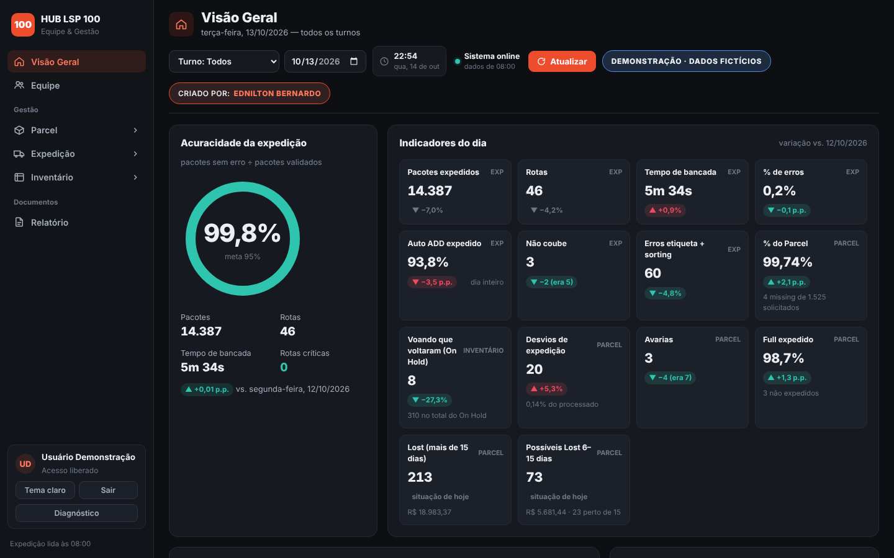
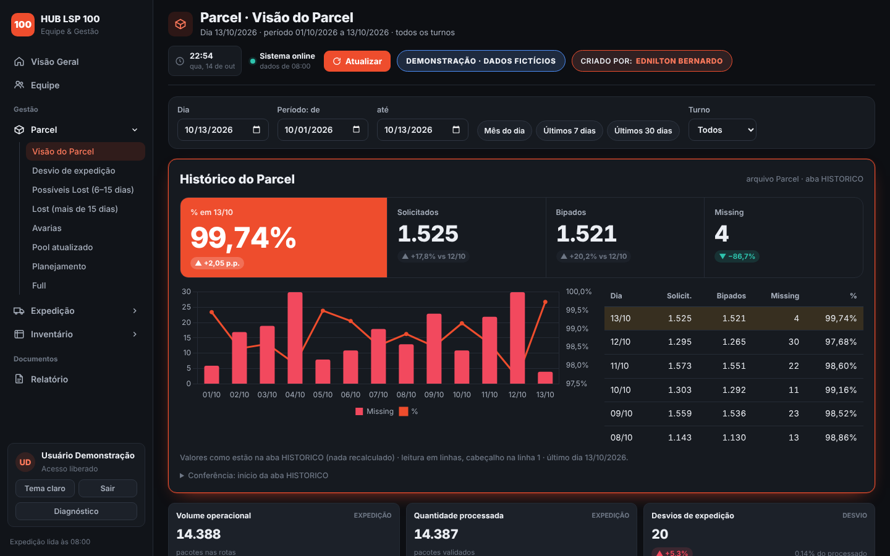
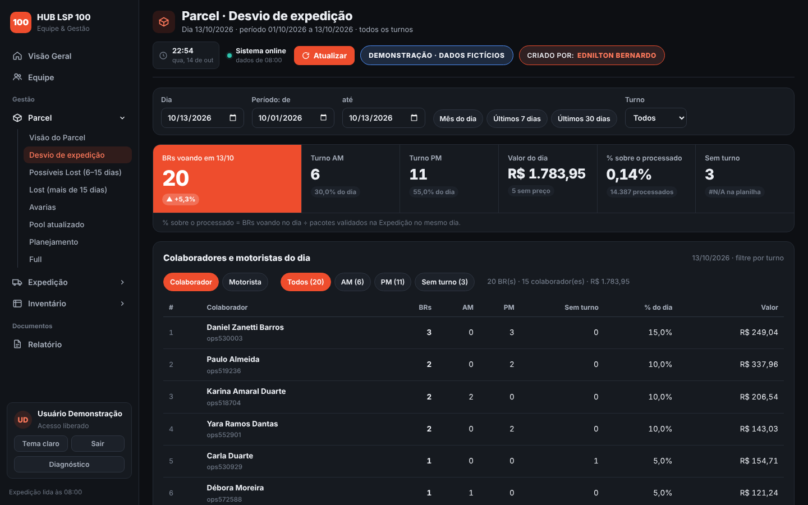
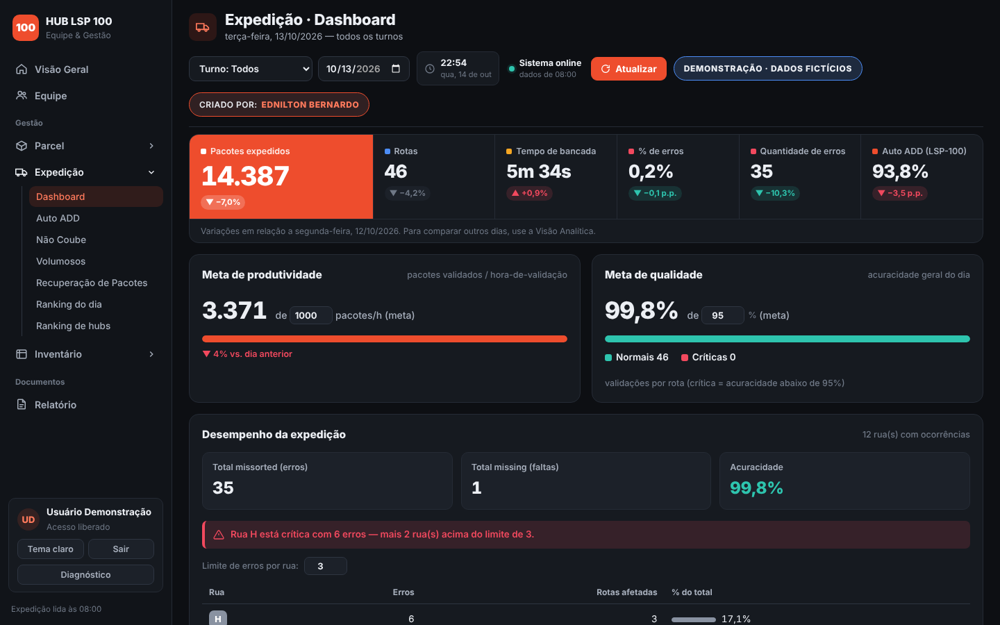
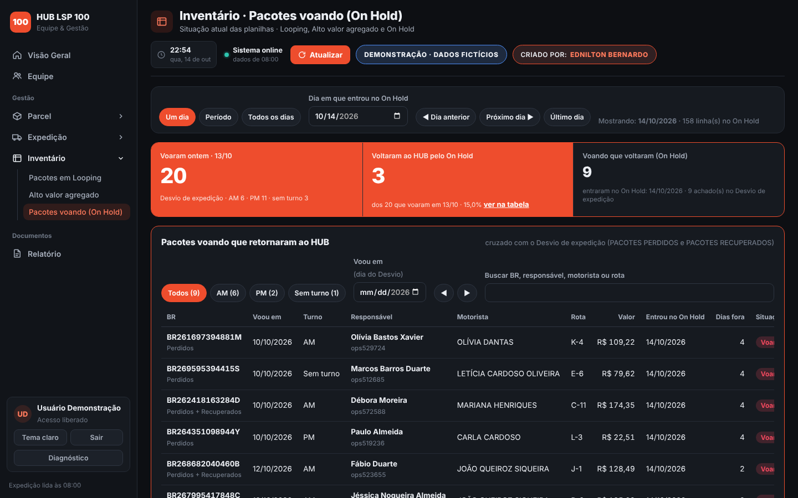
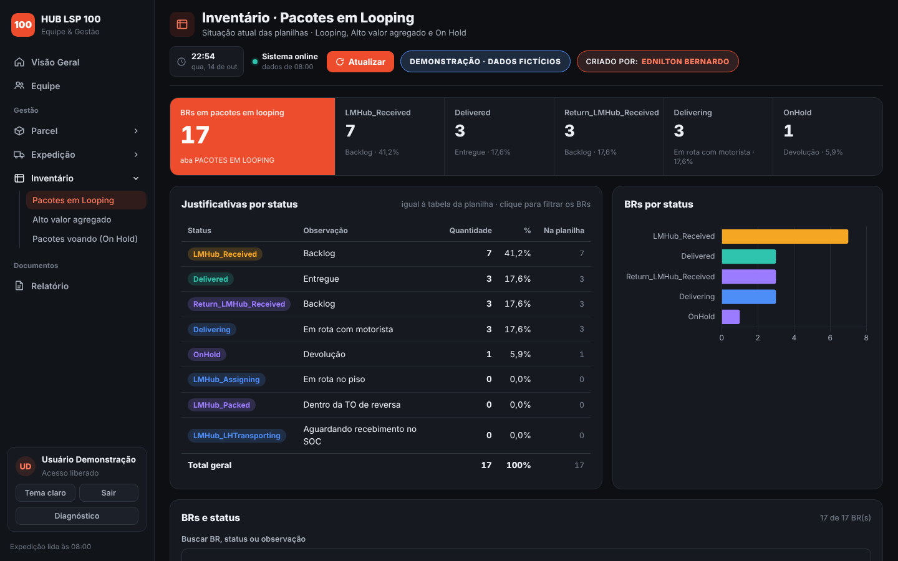

# Painel Operacional — HUB LSP 100 | Equipe & Gestão (demonstração)

**▶ Abrir a demonstração:** https://edniltonbernardo63.github.io/Painel-operacional/

Demonstração do painel operacional criado por **Ednilton Bernardo** para a gestão de um hub de última milha:
Expedição, Parcel (desvios, Lost, avarias, pool, planejamento, Full), Inventário (Looping, Alto valor agregado e pacotes voando no On Hold) e Equipe em um só lugar, com relatório
em PDF.

> **Todos os números, nomes, códigos de pacote e unidades desta demonstração são fictícios.**
> A versão de produção roda em Google Apps Script e lê as planilhas da operação; aqui as respostas do
> servidor vêm prontas dentro da página, então ela abre direto no navegador, sem login no Google.

## O que dá para ver

| Área | Conteúdo |
|---|---|
| **Visão Geral** | acuracidade, 13 indicadores do dia com variação vs. dia anterior, tendência, alertas e **Resumo por período** com gráficos (média do período e mês a mês) |
| **Equipe** | quadro de efetivo: ativos, escalas, turnos e líderes |
| **Parcel** | Visão do Parcel (% do Parcel em destaque), Desvio de expedição (colaboradores por turno), Possíveis Lost (6–15 dias), Lost (> 15 dias), Avarias, Pool, Planejamento e Full |
| **Expedição** | dashboard, Auto ADD, Não Coube, Volumosos, Recuperação, ranking do dia e posição da unidade entre os hubs |
| **Inventário** | Pacotes em Looping e Alto valor agregado (BR, status e justificativas), Pacotes voando (On Hold): quantos voaram no dia e quantos voltaram ao HUB, filtros por dia de voo, dia de entrada e turno, cruzado com o Desvio de expedição |
| **Relatório** | relatório do dia ou por período, com gráficos e escolha das abas (inclui lista de motoristas e Inventário), para imprimir/salvar em PDF |

Login da demonstração: os campos já vêm preenchidos — é só clicar em **Entrar** (qualquer e-mail e senha funcionam).

## Capturas

## Como funciona

- `index.html` é a página inteira (HTML, CSS e JavaScript, gráficos com Chart.js).
- Na produção, a página chama o servidor Apps Script (`google.script.run`). Na demonstração, um pequeno
  módulo no início do arquivo responde no lugar do servidor com os dados fictícios — o resto do código é o
  mesmo do painel real.
- Os dados fictícios foram gerados rodando o próprio código do servidor sobre planilhas sintéticas, então os
  cálculos (médias, % sobre o processado, Lost, ranking, etc.) seguem exatamente as regras do painel.

---
Criado por **Ednilton Bernardo**.
